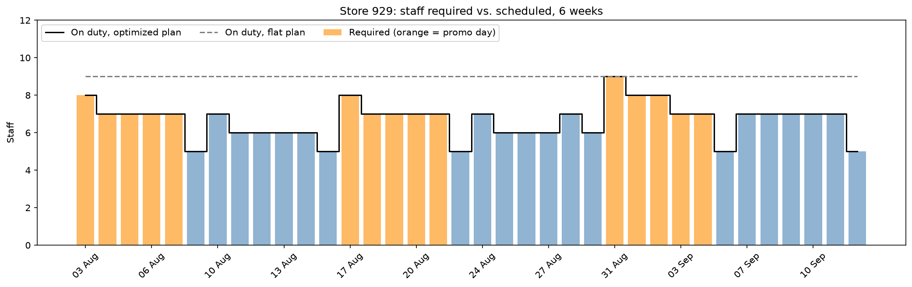
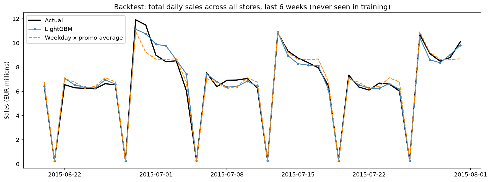
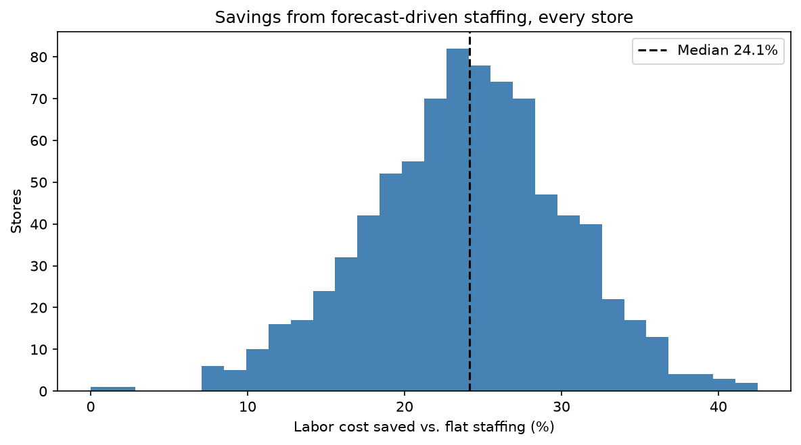

# Rossmann: 6-Week Demand Forecast and Cost-Minimizing Staffing Plan

**Live demo: [rossmann-demand-forecast-fa.streamlit.app](https://rossmann-demand-forecast-fa.streamlit.app/)**

Forecasting plus optimization on real retail data: predict the next 6 weeks of daily sales and customer
traffic for 1,115 Rossmann drugstores, then turn the forecast into the cheapest staffing plan that still
covers every day, solved in Python **and in Excel Solver**.



## Results

| | |
|---|---|
| Sales forecast error (WAPE), 6-week backtest on unseen data | **8.7%** (baseline 9.8%, naive 18.1%) |
| Customer-traffic forecast error (WAPE) | **6.8%** (baseline 8.6%) |
| Forecast bias | +0.1% (no systematic over- or under-forecasting) |
| Store 929, 6-week staffing cost | **30,960 EUR** vs. 42,048 EUR flat staffing: **26.4% saved** |
| All 829 Sunday-closed stores, 6 weeks | **8.26M EUR saved** (24.1%), median store 24.1% |
| Excel Solver vs. Python on the same model | **identical optimum** (30,960 EUR) |

## How it works

**1. Forecast.** A LightGBM model on log sales and log customers, with store, promotion, weekday, holidays,
calendar, competition and promo-campaign features. The last 6 weeks of history (June 20 to July 31, 2015)
were held out entirely; early stopping used a separate validation window. The model beats two baselines a
planner would actually use: each store's recent weekday average, and its weekday x promo average. It was
then retrained on all history and used to forecast August 1 to September 17, 2015 for 856 stores, using the
promotion calendar the company had already planned.



**2. Optimize.** Forecast customers become daily staff requirements:

> staff required = forecast customers x (1 + 10% safety buffer) / 120 customers per employee per shift,
> rounded up, minimum crew of 3

The 10% buffer sits above the forecast's 6.8% typical error. An integer program then picks:
- **full-time employees** by day-off pattern each week (each works 5 of the 6 open days, 640 EUR/week), and
- **part-time shifts** for any single day (152 EUR/shift, pricier per hour but flexible),

so that staff on duty >= staff required every day, at minimum total cost. That's 72 whole-number decisions,
inside Excel Solver's 200-variable limit.

**3. Excel Solver.** [`excel/staffing_plan.xlsx`](excel/staffing_plan.xlsx) builds the same model with live
formulas: blue cells are assumptions, yellow cells are Solver's decisions, green cells are results. The
Solver setup is saved in the workbook; open it and press **Data > Solver > Solve**. Notebook 03 runs Excel
Solver automatically from an empty plan and checks it lands on the same optimum as `scipy.optimize.milp`.



## Key findings
- **Promotions drive demand:** +39% sales, from 21% more customers who each spend 15% more.
- **Promotions also drive staffing.** Planning to an average day would leave store 929 short on 5 days,
  and all 5 are promotion days. The forecast's promo awareness is what makes the plan work.
- **Forecast-driven staffing saves about a quarter of labor cost** vs. staffing every day for the peak,
  with every day still covered. Stores with sharper weekly peaks save the most.

## Project structure

```
01_explore_sales.ipynb          Data checks and demand patterns (promotions, weekdays, seasonality)
02_forecast.ipynb               Baselines vs. LightGBM backtest, feature importance, 48-day forecast
03_staffing_optimization.ipynb  Integer program, all-store savings, Excel workbook + Solver verification
features.py                     Feature engineering and error metrics
staffing.py                     The staffing model (shared by notebook 03 and the app)
excel/staffing_plan.xlsx        The Excel Solver model, ready to solve
app.py                          Streamlit app: forecast explorer and live staffing optimizer
app_data/                       Forecasts, backtest and results the app reads
images/                         Charts used in this README
```

## Run it locally
1. Accept the competition rules and download the data from
   [Kaggle](https://www.kaggle.com/competitions/rossmann-store-sales/data) into `data/raw/`.
2. Install and run:
   ```bash
   python -m venv .venv
   .venv\Scripts\activate
   pip install -r requirements.txt lightgbm matplotlib openpyxl pyarrow ipykernel
   ```
3. Run the notebooks in order (01 → 03), then:
   ```bash
   streamlit run app.py
   ```

## Limitations
- Wage costs, customers per employee and minimum crew are illustrative assumptions, not Rossmann's figures;
  the app and the workbook let you change them and re-solve.
- Staffing is planned per day, not per hour, and treats employees as interchangeable.
- The forecast assumes the promotion calendar is known in advance and nothing unusual happens to a store.
- The savings are measured against a simple flat plan; an experienced store manager already does better.

## Tech stack
Python, pandas, LightGBM, SciPy (`milp`), Excel Solver (Simplex LP), openpyxl, Streamlit, Altair
